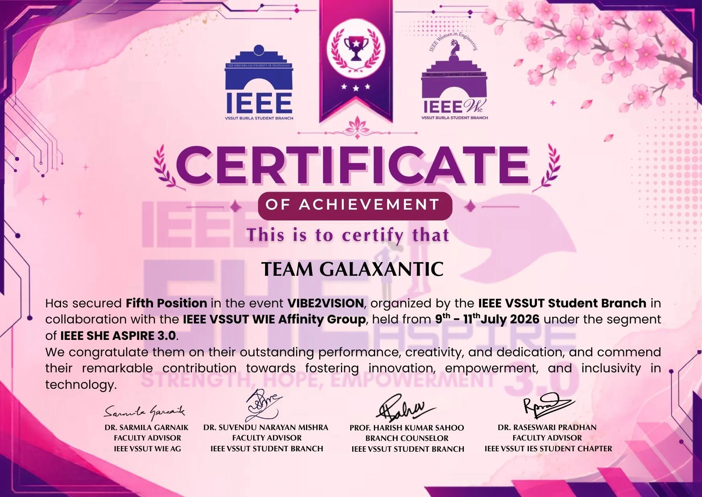

# 🌅 Herizon

> **Empowering women to grow, restart and lead.**

Herizon is an AI-powered career empowerment platform built for the **Vibe2Vision Hackathon** under **Track 3 – ElevateHer: Education, FinTech & Career Empowerment**.

## 📖 About

Herizon is designed to support women at every stage of their professional journey by combining AI-powered career guidance, opportunity discovery, and personalized learning into one platform.

Whether someone is returning after a career break, exploring new opportunities, or planning their next career move, Herizon provides the tools and guidance needed to grow with confidence.

---

# ✨ Features

Herizon is an **AI Career Operating System** powered by a **Shared Context Architecture**. Rather than isolated tools, Gemini 2.5 Flash understands your complete profile, resume analysis, and career gaps across every feature to provide hyper-personalized guidance.

## 💼 Career Break
Confidently return to work after any career break.
- AI Career Gap Analysis
- Missing Skill Detection
- Career Readiness Score

## 📄 Resume Intelligence
- PDF Resume Upload & Parsing
- AI-Powered Resume Scoring
- ATS Parsing Score
- Missing Skills Identification

## 🗺️ Interactive Roadmap
- AI-Generated 30/60/90-Day Action Plan
- Interactive Checklists & Milestones
- Database Persistence for Progress Tracking
- Built directly from your Resume gaps

## 🧭 Opportunity Navigator
Your personalized feed of internships, scholarships, fellowships, hackathons, and job openings.
- AI-Ranked Opportunities based on your Resume
- Eligibility Filtering & Deadlines
- Bookmark & Save Opportunities

## 🤖 AI Career Coach
Your always-on personal mentor.
- Context-Aware AI Chat (knows your resume & goals)
- Persistent Conversation History
- Interview Preparation
- Personalized Career Guidance

## 📰 HerLens
Daily bite-sized, AI-summarized news focusing on women in business, tech, and leadership.
- Powered by NewsData.io
- Gemini Bullet-Point Summaries
- Category-based Filtering
- Fast Supabase Caching

## 💰 Financial Compass
Plan your financial independence with a hybrid approach.
- Deterministic Financial Math & Health Scores
- AI-Generated Budget Strategies
- 30/60/90-Day Financial Action Plan
- Saved Financial Plans

---

# 🎨 Design Language

**Elegant Minimalism × Soft Pastel**

### Color Palette

| Color | Hex |
|--------|------|
| Champagne | `#F5E6D1` |
| Light Red | `#FFC8CB` |
| Rose Gold | `#B46C72` |
| Puce Red | `#6E2E34` |
| Rackley | `#5E7B9B` |

---

# 🛠 Tech Stack

### Frontend
- Next.js 16 (App Router)
- React 19
- TypeScript
- Tailwind CSS
- Framer Motion

### Backend
- Supabase (PostgreSQL, Auth, Storage)
- Row Level Security (RLS)
- Next.js Server Actions

### AI & APIs
- Google Gemini 2.5 Flash API (Model Fallback Chain)
- `@google/genai` SDK
- NewsData.io API

### Deployment
- Vercel

---

# 👥 Team

**Team Name:** **Galaxantic**

| Member | GitHub |
|--------|--------|
| Nilutpal | https://github.com/NeeL21YT |
| Taesonia | https://github.com/taesonia |

---

# 🏆 Hackathon

**Event:** Vibe2Vision Hackathon

**Track:** ElevateHer - Education, FinTech & Career Empowerment

**Result:** 🏅 **5th Place** — Team Galaxantic secured Fifth Position at Vibe2Vision, organized by IEEE VSSUT Student Branch in collaboration with IEEE VSSUT WIE Affinity Group (IEEE SHE ASPIRE 3.0), 9–11 July 2026.

---

# 📄 License

Developed by **Team Galaxantic** for the **Vibe2Vision Hackathon 2026**.
